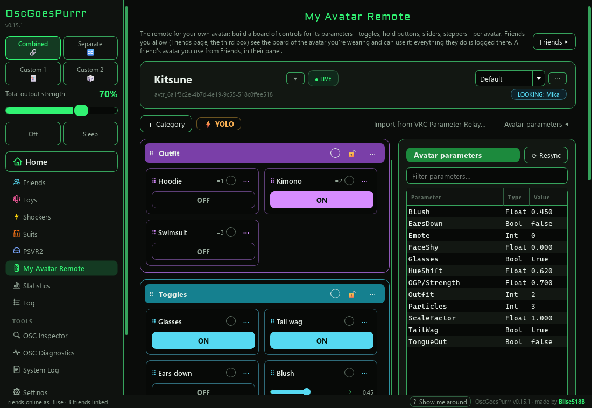

# Your board

The **Avatar Remote** is VRC Parameter Relay's board, built into OGP: your
avatar's parameters as toggles, hold buttons, sliders and steppers, sorted
into coloured categories. You use it, your avatar's menu can use it, and
friends you allow can use it too.

Switch it on first: Settings → Features → **Avatar Remote — avatar boards
friends can use too**, or tick **An avatar remote friends can use too** in
*What are you here for?*. It's off by default. Its page is **My Avatar
Remote**.

*My Avatar Remote: the worn avatar's board with its categories, the Height box, and the parameter list on the right.*

## Build a board

1. Wear your avatar, with VRChat's OSC on. Its board opens by itself.
2. Press **＋ Category** for a box to put controls in. Each category has a
   colour.
3. Open the parameter list with **Avatar parameters ◂**. Double-click a
   parameter, or drag it onto a category, to make a control.

The kind follows the parameter's type: a **toggle** for a Bool, a
**stepper** for an Int, a **slider** for a Float. **⋯ → Edit** on a card
changes its label, its kind or its range, or inverts a toggle (**⇄**, for a
parameter whose logic is backwards).

An Int can be several **toggles** or **hold buttons** too, each setting its
own value (Outfit = 1, 2, 3 …, shown as `=2` on the card). They switch each
other off, like VRChat's own menu.

## Move and remove

- Drag a card by its **⠿** to move it, and a category by the **⠿** in its
  header.
- To remove a control, drag it back onto the parameter list. The list lights
  up with **Drop to remove**; the control goes at once, with **Undo** for a
  moment. A whole category asks first.
- [Ctrl+Z](../settings/undo.md) takes back any change to a board.

## Avatars and presets

- Every avatar keeps its own board. Give it a name in **Avatar name** and it
  stays in the **▾** list, so you can edit its board while you wear something
  else. **✎ OFFLINE** then means nothing is sent.
- An avatar can have several **presets**: the drop-down at the top. **⋯** next
  to it adds, renames and deletes them. A category's **⋯** copies it to another
  preset.
- **⟳ Resync** reads the avatar's parameters again.

## Lock a category

A category's **🔒** makes it look-only for friends. You can still use it,
and so can your own avatar menu.

## Bring your Relay boards

Built boards in VRC Parameter Relay already? **Import from VRC Parameter
Relay…** copies them all. The Relay's own files stay as they are.
