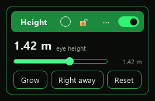

# The Height box

The **Height** box on My Avatar Remote changes your height in VRChat, the way
the OSC scaler tools do. It sits under your categories.

*The Height box: your height now (1.42 m), the slider, Grow, Right away and Reset. Its top bar has the menu slot, the lock, ⋯ and its switch.*

- **Your height now**: your eye height, live from VRChat.
- The slider picks the **height to go to**, between your lowest and highest.
- **Grow** glides there, gently. **Right away** jumps.
- **Reset** takes you back to your own height: what VRChat reported before
  anyone changed it.

## Settings

**⋯** in its top bar folds out:

- **Lowest height** and **Highest height**: the smallest and tallest anyone
  can make you, you included. By default VRChat's own menu range, 0.2–5 m.
  Never past 0.1–100 m, where VRChat warns things can break.
- **Grow speed**: how long Grow takes to double or halve your height. Slower
  is gentler on VRChat's view.

Nobody else can change these.

## Friends and your height

- Friends you allow your **Avatar** see the box on their copy of your board,
  and can change your height.
- The box's own switch (**Height for friends**, on by default) takes it away
  from them: they don't see it, and nothing they send changes your height.
- **🔒** makes it look-only for friends.
- Pause all holds it, like everything else.
- When a friend stops or leaves, your height stays where they put it.

The circle in its top bar puts your height on one of your avatar menu's
seven [radials](./menu-slots.md).

## When a world says no

A world can forbid changing your height. The box then greys out and says so.
A world's own limits win over what you set.
