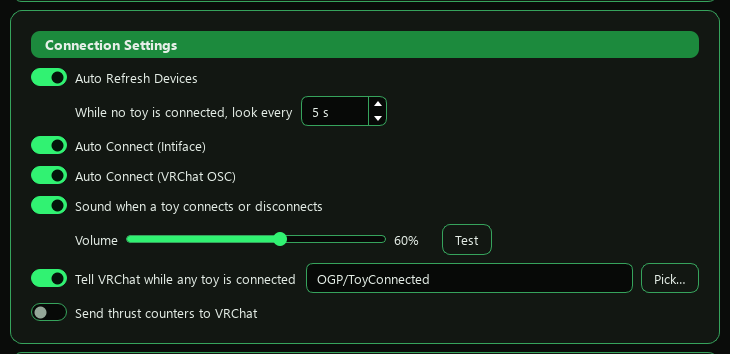

# "It's connected" parameters

OGP tells your avatar whether each toy, suit and shocker is connected, so the
avatar can light an icon, swap a material or switch an object on. They're
plain **Bool** parameters, **all on by default**, under fixed names an avatar
asset can count on.

*Settings → Connection Settings, with Tell VRChat while any toy is connected.*

| What | Where you set it | Default name | True while |
|---|---|---|---|
| Any toy | Settings → Connection Settings → *Tell VRChat while any toy is connected* | `OGP/ToyConnected` | at least one toy is connected |
| One toy | Toys → the toy's card → **Avatar parameters** → *Tell VRChat while this toy is connected* | `OGP/<ToyName>Connected`, like `OGP/LovenseLush3Connected` | that toy is connected |
| bHaptics suit | Suits → bHaptics → *Tell VRChat* → Any part | `OGP/BHapticsConnected` | at least one part is connected |
| One bHaptics part | the same card, a row per part you have | `OGP/BHapticsVestConnected`, `…SleevesConnected`, `…HandsConnected`, `…FeetConnected`, `…HeadConnected` | that part is connected |
| OWO suit | Suits → OWO → *Tell VRChat* | `OGP/OWOConnected` | OGP is connected to My OWO |
| Any shocker | Shockers → Hub → *Tell VRChat while a shocker is connected* | `OGP/ShockerConnected` | the hub is connected and a shocker is in use |
| One shocker | Shockers → the shocker's card → *Tell VRChat* | `OGP/Shocker1Connected`, `OGP/Shocker2Connected` … numbered like the cards | the hub is connected and that shocker is On |
| PSVR2 headset | PSVR2 → *Tell VRChat while the headset is connected* | `OGP/PSVR2Connected` | the headset is connected |

Each one can be renamed or switched off where it's listed. The suits',
shockers' and headset's are only sent while that feature is on.

## Use one on your avatar

1. Add a **Bool** with the same name to your avatar's Expression Parameters.
   Unsynced is fine if only you need to see it; synced if others should.
2. Drive whatever you like from it in your FX layer.

A parameter your avatar doesn't have is ignored by VRChat. Two things with the
same name share one parameter: true while either is connected. A Float or Int
parameter gets 1 and 0.

OGP sends them again every time you change avatar or VRChat reconnects, and
sets them all to false when you close it. So an avatar never shows a device
that's gone.

## Thrust counters

Settings → Connection Settings → **Send thrust counters to VRChat** (off until
you switch it on) sends three counters as **Int** parameters, the same
numbers as the Statistics page:

| Counter | Parameter | Counts | Digits |
|---|---|---|---|
| Total | `OGP/Thrusts/Total` | every thrust on record | `/D1` … `/D7` |
| Session | `OGP/Thrusts/Session` | since OGP started | `/D1` … `/D5` |
| Pace | `OGP/Thrusts/PerMin` | thrusts in the last 60 seconds | `/D1` … `/D3` |

An avatar Int holds 0 to 255, so the plain parameter stops at 255. For a
number display, use the digits: each is an Int 0–9, `/D1` the ones, `/D2` the
tens, and so on. `OGP/Thrusts/Total/D3` is the hundreds of the total. Add only
the ones your asset uses; synced costs 8 bits each.

Only changes go out, at most once a second. With Usage statistics off there's
nothing to count, so nothing is sent.
