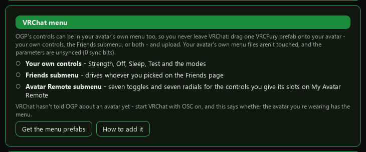

# The avatar menu

OGP's controls can live in your avatar's own menu, so you never leave
VRChat: strength, Off, Sleep, Test and the modes, a **Friends** submenu that
drives whoever you picked in OGP, and the **Avatar Remote**'s slots.

*Settings → VRChat menu: the three parts of the menu, whether the avatar you wear has them, and the download.*

## Add it with VRCFury

You need [VRCFury](https://vrcfury.com) in your avatar's Unity project
(Creator Companion → Manage Project → add VRCFury).

1. Download
   [OscGoesPurrr-VRCFury.unitypackage](https://github.com/Blise518B/OscGoesPurrr/releases/latest/download/OscGoesPurrr-VRCFury.unitypackage)
   (Settings → VRChat menu → **Get the menu prefabs** does the same) and import
   it into your avatar's Unity project.
2. Drag **one** of its prefabs from the new `Assets/OGP` folder onto your
   avatar, anywhere inside it:
   - **OscGoesPurrr Menu**: everything, your own controls and the Friends
     menu, in one *OscGoesPurrr* submenu.
   - **OscGoesPurrr Menu (Self)**: only your own controls (Avatar Remote
     included).
   - **OscGoesPurrr Menu (Friends)**: only the Friends menu, as an *OGP
     Friends* submenu.
3. Upload.

VRCFury adds the parameters and the submenu when you upload. The parameters
are unsynced, so they cost 0 sync bits. Your avatar's own menu and parameter
files aren't touched: to take it out again, delete the object.

The submenu lands in your root menu. To put it in another submenu, type that
submenu's name into the **Prefix** field of the prefab's Full Controller.

A newer package imports over the old one and updates it in place.

**No VRCFury?** The
[setup guide](https://github.com/Blise518B/OscGoesPurrr/blob/main/docs/VRCHAT_MENU.md)
has a one-click installer for Unity and the manual way.

## Does my avatar have it?

Settings → **VRChat menu** says, for the avatar you wear, which of the three
parts it has: **Your own controls**, **Friends submenu**, **Avatar Remote
submenu**. The Friends page says it too.

## Your own controls

| Parameter | Type | What it does |
|---|---|---|
| `OGP/Strength` | Float 0–1 | Total output strength. Never touches your tuning. |
| `OGP/Mode` | Int 0–3 | The active mode: 0 Combined, 1 Separate, 2 Custom 1, 3 Custom 2. Renaming a mode doesn't change its number. |
| `OGP/Off` | Bool | Panic silence. Off again and your level comes back. |
| `OGP/Sleep` | Bool | Toys wake only after three full strokes within six seconds. |
| `OGP/Test` | Bool, held | While held, every connected motor runs at about 20 %. |

The menu and the app agree both ways: a change in OGP shows in your menu.
After you load an avatar, OGP sends its own values; for about two seconds it
ignores what VRChat replays then. So an avatar swap never changes your
settings.

## The Friends submenu

It acts on whatever you picked on the Friends page: a friend, or a group.
Each friend only gets what they allow you. To drive yourself and a friend at
once, put yourself in a group with them (see
[Groups and Me](../friends/groups-and-me.md)).

- **Toys ▸**: a level (`OGP/Friend/Level`), an auto mode (Sine, Square,
  Triangle, Saw, Random, Heartbeat, Build-up, Oscillate) with its speed and
  range, **Override**, which of their toys 1–4, and a stop.
- **Shockers ▸**: Shock, **Shocker vibrate** and Beep buttons, strength and
  length as a part of *their* caps, PiShock's Small warning, which shockers
  1–4, and a stop. A shock is a vibrate while they haven't armed.
- **Their strength**: their total output strength slider. It moves on their
  screen too.

Every parameter is listed in the
[setup guide](https://github.com/Blise518B/OscGoesPurrr/blob/main/docs/VRCHAT_MENU.md#friends-ogpfriend).

## The Avatar Remote submenu

Seven toggles and seven radials (`OGP/Remote/Toggle1`–`7`,
`OGP/Remote/Radial1`–`7`) that you hand out to controls on the My Avatar
Remote page. See [Menu slots](../avatar-remote/menu-slots.md).

:::tip
Added the menu to an avatar you've used before, and nothing happens when you
tap it? VRChat keeps an old list of the avatar's parameters. See
[Common problems](../help/common-problems.md#the-avatar-menu-does-nothing).
:::
