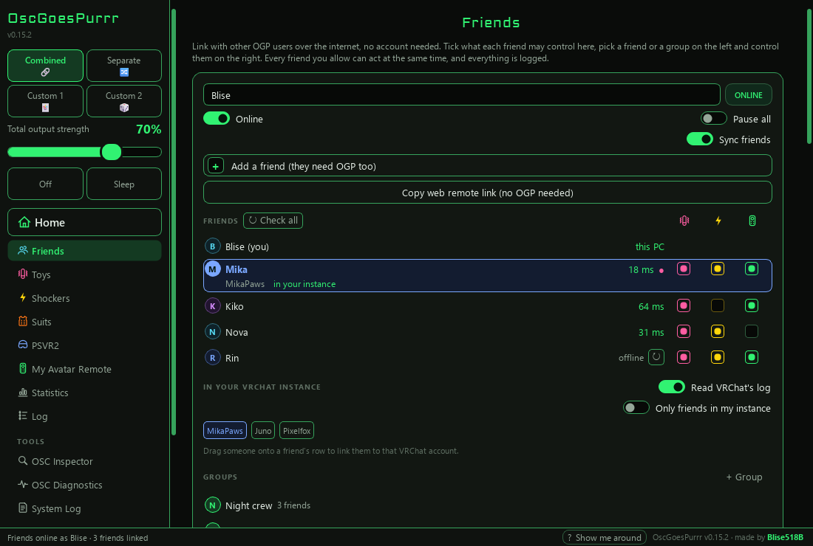
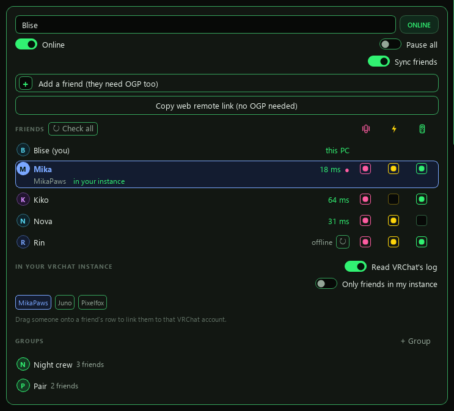

# Adding friends

Friends link two OGPs over the internet, so each can drive the other's toys,
shockers and avatar, as far as the other allows. There's no account and no
server of ours: the two PCs talk directly, with free relays as a fallback
when a direct line isn't possible.

Friends is on by default (Settings → Features → **Friends — control each
other over the internet**). Nothing goes online until you pick a nickname.

*The Friends page: your nickname and Online at the top, the friend list, and the picked friend's panel below.*

## 1. Pick a nickname

Type it into the box at the top. That's the name your friends see. Then OGP
goes online, and the **Online** switch beside it is remembered from then on.
Switch it off to go offline.

## 2. Send an invite link

1. Press **＋ Add a friend (they need OGP too)**. It opens by itself while
   you have no friend yet.
2. Under **SEND AN INVITE LINK**, pick how long it works:
   - **Once**: the first friend who clicks it, within a day;
   - **1 day** / **1 week**: anyone who clicks it in that time;
   - **No end**: anyone who clicks it, until you close it.
3. Press **Copy invite link** and paste it into Discord. It's a link that
   works in a browser too, with "(Add *your name* on OscGoesPurrr)" under it.

Your friend clicks it, OGP opens on their PC, and you're friends.

### Or swap IDs

Under the link is **your ID**, with **Copy**. A friend pastes it under **GOT
THEIR LINK OR ID?** and presses **Add**; you press **Accept** when they ask.
Your ID stays the same every time you open OGP. It's not a password: someone
who has it can only ask to be your friend.

### Close your links

**⋯** next to Copy invite link:

- **Close all invite links**: every link you sent stops working. Your friends
  stay.
- **New ID - unfriend everyone…**: for a link that got out of hand. Every
  friend is unlinked, and every link and your old ID stop working.

## The friend list

*The list: you first, then your friends with their ping (Rin is offline, with ↻), your VRChat instance, and your groups.*

- **You** are always first: the **Me** row, "this PC". See
  [Groups and Me](./groups-and-me.md).
- Each friend shows their ping while linked, or **offline**.
- The three columns are what each friend may use: toys, shockers, your
  avatar. See [What each friend may do](./what-they-may-do.md).
- Click a friend to open their panel below. See
  [Driving a friend](./driving.md).

### Offline? Check now

OGP looks for offline friends in the background, gently, so the link stays
light. To look right away:

- **↻** on an offline friend's row looks for that friend now;
- **↻ Check all** next to FRIENDS looks for everyone who shows offline.

The row says **checking…** until they answer or the try gives up. Each friend
is looked for at most once every 10 seconds, however often you click.

### Versions

Each OGP tells its friends its version. The first time a friend's is newer
than yours, OGP says how to update, and an amber banner stays on the Friends
page. A friend on an older version gets an **OLD** tag on their row.

## Unfriend

At the bottom of a friend's panel: **Unfriend *name*…**. The other side drops
you too.

:::note
One OGP per PC goes online. A second OGP window on the same PC stays offline.
:::
