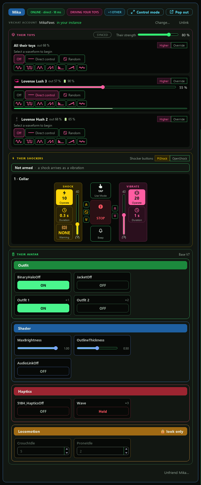
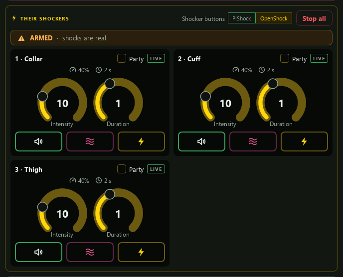
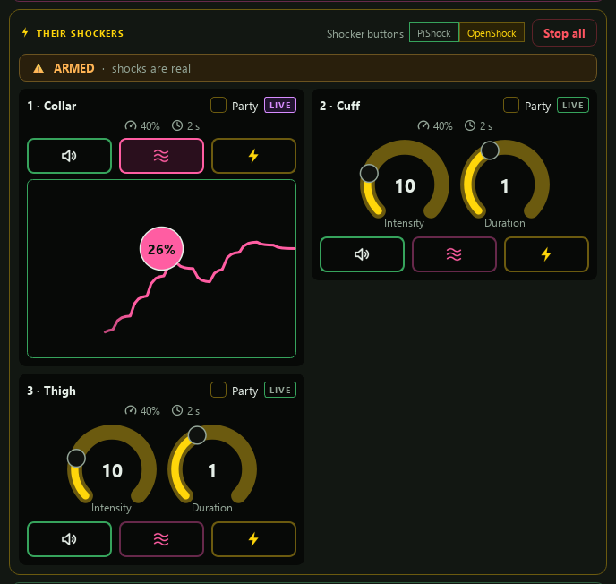
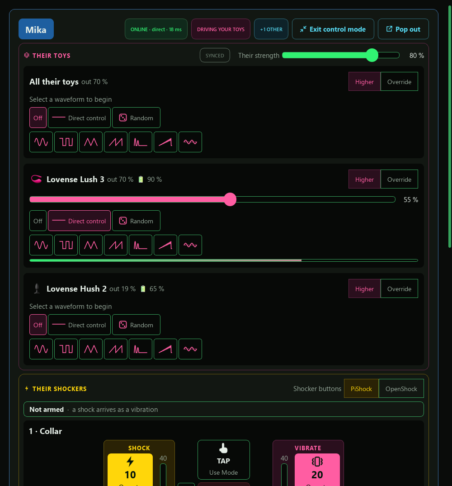

# Driving a friend

Click a friend in the list and their panel opens below it: their toys, their
shockers and their avatar, as far as they allow you.

*Mika's panel: their toys, their Collar as PiShock's panel, and the board of the avatar they wear.*

## The header

- **ONLINE · direct · 18 ms**: linked, and how.
- **DRIVING YOUR TOYS**: they're driving yours right now.
- **+1 OTHER**: someone else drives them right now. Hover for the names.
- **Control mode** and **Pop out**: see [below](#control-mode).

## Their toys

- **All their toys** drives every toy they have at once; a card per toy drives
  that one.
- **Off**, **Direct control** (a slider) and **Random**, then the patterns:
  Sine, Square, Triangle, Saw, Heartbeat, Build-up and Oscillate.
- **Higher** (the default): their toy runs at the higher of your level and
  what their own avatar does. **Override**: your level replaces theirs.
- **Their strength**: their total output strength slider. It moves on their
  screen too; whoever moves it last wins.

Their strength, their Off and each toy's output band still hold on their
side. Your level drops to zero when your updates stop.

### Several of you on one friend

**Sync with others** is their choice, not yours (on by default): everyone
driving them shares one set of toy cards, and they feel only the newest
change. With it off, each of you drives on your own, and the highest level
wins. Their panel says **SYNCED** or **SEPARATE** beside **+1 OTHER**.

## Their shockers

**Shocker buttons: PiShock | OpenShock**, in the header of THEIR SHOCKERS,
picks whose buttons you drive with: **PiShock**'s own panel (the default) or
**OpenShock**'s card. It's one setting for every panel (each friend's, your
own and every group's), and OGP remembers it. It only changes how the
buttons look: the same press sends the same thing, and everything they
allow you holds either way.

### PiShock's panel

It feels familiar if you've used PiShock: **Shock** and **Vibrate** with
their strength, **Duration** and **Warning** (None, Small 1–3 s, Mid 3–6 s,
Long 6–9 s), **Use Mode** (Tap, Remote, Continuous), **STOP** and **Beep**.

### OpenShock's card

*Nova's three shockers with OpenShock's buttons.*

It feels familiar if you've used OpenShock:

- **Intensity** and **Duration** dials, then **Sound**, **Vibrate** and
  **Shock**. One Intensity goes for Vibrate and Shock, and each stops at its
  own most. The Duration runs from 0.3 s up to their longest pulse.
- A press runs for the Duration, and the button stays lit. Press it again
  to stop it.
- **Stop all** stops their shockers, even when they have only one.

#### Live control

**LIVE**, in the card's corner, swaps the dials for **Live control**: pick
Sound, Vibrate or Shock, then hold and drag on the pad. The strength follows
your finger until you let go, and the top is the most they allow you.

*Live control on the Collar: the strength follows the finger, the line shows the last three seconds.*

- It holds their shocker like PiShock's Remote mode: their longest hold and
  the rest after it still apply.
- It stops when you let go, and when your link goes quiet.

### On both

- Strength is a part of *their* limit: the slider's top is the most they
  allow you.
- **Not armed · a shock arrives as a vibration** means they haven't armed.
- What they don't allow you is greyed, and the card says why.
- **Party**: tick it on several shockers (one friend's, or everyone's in a
  group) to drive them from one panel: **Sync** (all at once), **Random** (one
  each press), or **Round Robin** (one after the other).

## Their avatar

Under **THEIR AVATAR**: the board of the avatar they're wearing, if they use
the [Avatar Remote](../avatar-remote/friends.md) and let you. A locked
category is look-only.

## Control mode

**Control mode** fills the page with the panel, big, for VR. **Exit control
mode** puts it back.

*Control mode: Mika's toys and shockers, big enough to use with a VR pointer.*

### The Control window

**Pop out** puts the panel, big, in a window of its own: **OscGoesPurrr ·
Control**. A VR overlay (XSOverlay, OVR Toolkit, Desktop+) can then show just
that window.

- It follows whoever you pick on the Friends page.
- It keeps working with OGP's main window minimized or in the tray.
- **Stay on top** keeps it above other windows.
- It remembers its size and place. It never opens by itself at launch.
- Nothing in it opens a popup window, which an overlay wouldn't show.
- Close it, or press **Back into the page**, and the panel goes back.

## From your avatar's menu

The [avatar menu](../avatar/menu.md)'s Friends submenu drives whoever you
picked here: their toys, their shockers and their strength. A change on the
page shows in the menu, and the other way round.

## The log

The Friends page's log has two views: **As it happens** (every line as it
comes) and **By person** (a row per person with their last action; ▸ unfolds
what they did). **Whole log ▸** opens the [Log page](../records/log.md).
