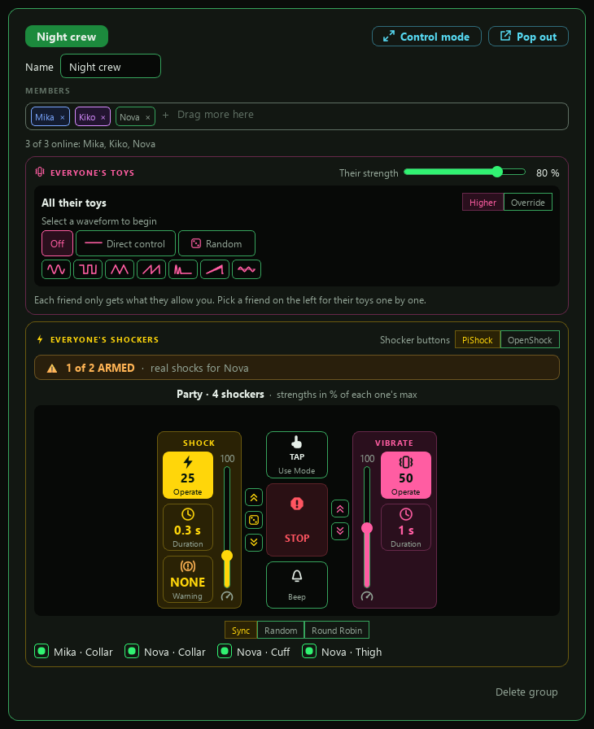

# Groups and Me

## Me

You're always first on your own list: **you**, "this PC". It's a working
friend who may do everything, over a loop inside OGP instead of the network.
Click it and you drive your own toys, shockers and avatar from the same panel
your friends use.

Every friend rule still holds for it: Pause all, your shockers' switches,
arming and limits. It can't be removed, and your real friends never see it.

## Groups

A group drives several people at once from one panel.

1. Under **GROUPS**, press **+ Group** and give it a **Name**.
2. Drag a row from the friend list onto the group's row, or onto its members
   box. A friend can be in several groups.
3. Click the group to open its panel.

*A group's panel: its members as chips, and their toys and shockers together.*

- The panel lists the members as chips. **×** on a chip takes that person
  out. **Delete group** removes the group, not the friends.
- Each member still only gives you what they allow you.

## You and a friend at once

Drag **yourself** into a group with a friend. You're a member like any other,
so the group's panel, and your avatar menu's Friends submenu with the group
picked, drive both of you: your own toys and shockers follow too, through
your own shocker page, your limits and arming.
