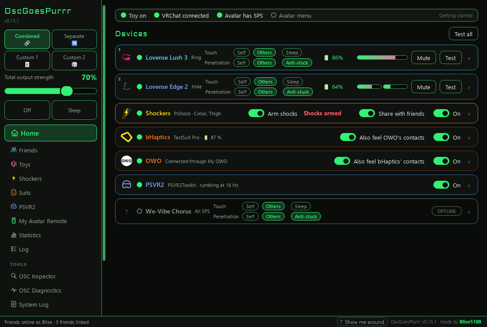

# OscGoesPurrr

**All your VRChat haptics, in one app.**

OscGoesPurrr (OGP) reads the contacts on your VRChat avatar and turns every
touch into real-time output on your devices:

- **Bluetooth toys**: Lovense, We-Vibe, Kiiroo and anything else
  [Buttplug.io](https://buttplug.io/) supports.
- **Shockers**: PiShock and OpenShock, over the hub's USB cable.
- **Suits and more**: bHaptics and OWO suits, SteamVR trackers with a motor,
  and the PlayStation VR2 headset's rumble.

Friends can drive all of it over the internet, from their own OGP or from a
link in their browser. You decide what each of them may use.

It's one file for Windows, and an AppImage for Linux. The toy server is
built in, and OGP finds VRChat and your toys by itself: no IPs, no ports.

*Home: two toys, the shocker hub, both suits and the headset, each with its quick switches. The sidebar on the left has the modes, total strength, Off and Sleep.*

## What you need

- A Windows PC (10 or 11), or Linux. Bluetooth for your toys.
- VRChat with OSC switched on.
- An avatar with **SPS** contacts (VRCFury's sockets and plugs; older OGB
  and TPS setups work too). That's the standard toy setup.
- Optional: [VRCFury](https://vrcfury.com) in your avatar's Unity project, for
  [OGP's own menu](./avatar/menu.md).

## How this guide is laid out

- [Getting started](./getting-started.md): from download to your first buzz,
  step by step.
- [Toys](/toys/): Home, the Toys page, modes and strength, where the toy
  server runs, and anti-stuck and Sleep.
- [Your avatar](/avatar/): OGP's menu in your avatar, the parameters OGP
  sends back, and SPS 3 avatars.
- [Shockers](/shockers/): the hub, the safety rules, behaviours and
  ShockOSC avatars.
- [Friends](/friends/): adding friends, what each may do, driving them,
  groups, the web remote and VRChat accounts.
- [Avatar Remote](/avatar-remote/), [Suits and trackers](/suits/),
  [PSVR2](./psvr2.md), [Records](/records/) and
  [Settings and tools](/settings/).
- [Common problems](./help/common-problems.md): what goes wrong, why, and
  what to do.

:::tip
OGP explains itself too. Rest the mouse on anything in the app to see what it
does, or press <kbd>F1</kbd> on any page for its steps on top of the page.
:::

## Not in this edition

DG-Lab Coyote e-stim and The Handy aren't in this edition yet. The
[roadmap](pathname:///OscGoesPurrr/#roadmap) on the website says what's
coming.
