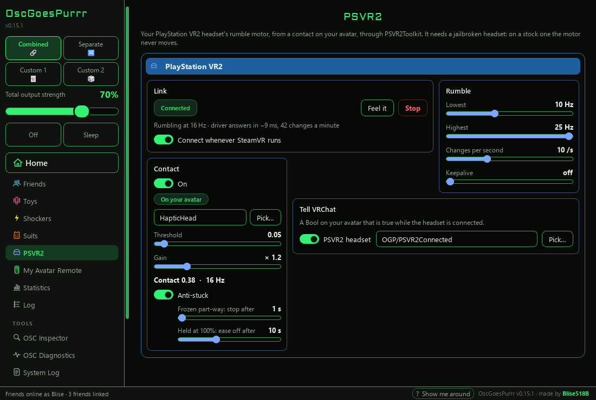

# PSVR2 headset rumble

The PlayStation VR2 headset has a rumble motor. OGP drives it from one
contact on your avatar: a light touch is a slow thump, a full one a fast buzz.

Switch it on first: Settings → Features → **PSVR2 — the headset's rumble,
through PSVR2Toolkit**, or tick **A PlayStation VR2 headset** in *What are
you here for?*. It's off by default, and Windows only.

*The PSVR2 page: the link to the toolkit, the rumble band, the contact that drives it, and Tell VRChat.*

## What you need

- **PSVR2Toolkit**, one of its **experimental** builds (the stable release
  doesn't have what OGP talks to). You install it yourself; OGP never bundles
  it. Run it once so OGP can find it.
- A **jailbroken** headset. On a stock one the commands go through and the
  motor never moves.
- SteamVR running with the toolkit.

## Set it up

1. Start SteamVR with the toolkit. **Link** says when OGP is joined to it.
   **Connect whenever SteamVR runs** (on once the feature is on) does that by
   itself.
2. Under **Contact**, press **Pick…** and choose the contact receiver on your
   avatar that drives it. A Haptic Pancake avatar has `HapticHead`.
3. Press **Feel it**. Silent while the page says connected? The headset isn't
   jailbroken.
4. Set the rumble band: **Lowest** and **Highest**. The motor does 10–25 Hz;
   0 is off.

## Safety

- Off, total output strength, VRChat going silent,
  [Off while away](./settings/away.md) and its own
  [anti-stuck](./toys/toy-safety.md) (at the bottom of the **Contact** card,
  with its own times) all hold it back.
- If OGP stops sending, the motor stops within half a second.
- **On** on Home's headset row (or **Stop** on this page) stops it.

**Tell VRChat while the headset is connected** sends `OGP/PSVR2Connected`.
