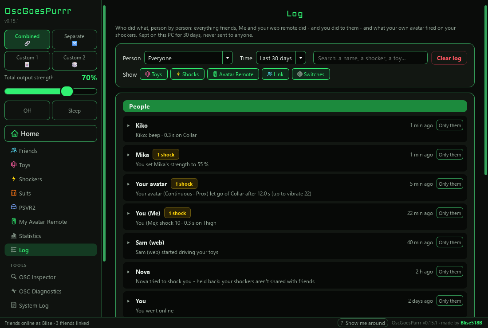

# The Log

The **Log** page keeps everything friends, the web remote, you and your
avatar did to your toys, shockers and avatar, for 30 days. It shows while
Friends or Shockers is switched on.

*The Log: a row per person with their last action, and every entry below, newest first.*

## What's in it

- who: a friend, you (Me), a web remote guest, a group, or **Your avatar**
  (your own shocker behaviours, by name);
- what: toys, a shock, vibrate or beep with its level and shocker, an Avatar
  Remote set, a link coming or going, a switch;
- and why, if something was held back ("shocks from them are switched off",
  "not here").

Where OGP sent less than was asked, the entry says what they asked for, with
what went out and why in a muted line under it: "Mika: vibrate 30 · 2.0 s on
Collar", then "Cut to 1.0 s: your longest pulse". Statistics count what went
out.

## Find something

1. Click a person in the list at the top for only what they did.
2. **Person** also offers everyone but your avatar's own behaviours.
3. The kind chips leave out what you don't need: only shocks, only toys …
4. **Time**: the last hour, today, the last 7 days, or everything.
5. **Search the log**: a name, a shocker, a toy. Entries with all of the
   words show.

**Clear log** deletes the whole log on this PC, after asking. It can't be
undone.

## On the Friends page

The Friends page's log card has two views: **As it happens** and **By
person** (a row per person, last action first; ▸ unfolds what they did).
Shocks stand out. **Whole log ▸** opens this page.

:::info
The log is one file per day in OGP's settings folder, on your PC only. It's
never sent to anyone: friends see only their own panel.
:::
