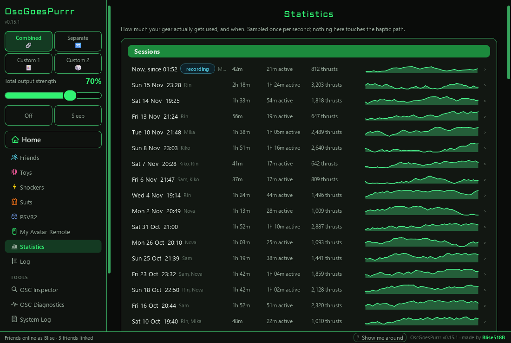
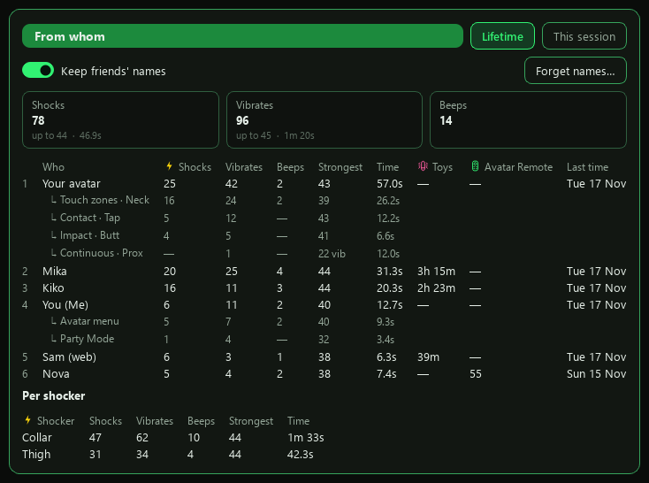

# Statistics

How much your gear gets used, and when. Statistics stay on your PC and are
never sent to anyone, friends included.

It's on by default (Settings → Features → **Usage statistics**). Switching it
off stops recording and keeps what's recorded. **Delete statistics…**, right
under the switch, deletes it all.

*Statistics: every session with its length, active time, thrusts and a sparkline. The running one says recording.*

## Sessions

Each session with its length, active time, thrusts, who you were with, and a
sparkline. **Show more** lists older ones. Click a session for its page:

- its **timeline**: each toy's intensity, thrusts per minute and which zones
  were touched;
- a **Shockers** lane: a mark for every shock, vibrate and beep, as tall as it
  was strong. Hover for when, how strong, how long, which shocker and from
  whom;
- its totals and an analysis: active time, thrusts, pace, your longest streak
  and your hottest five minutes, plus who drove you and what reached your
  shockers.

## Lifetime

Totals since you started, and **Fun facts**. Suits and trackers get their
on-time next to your toys once one has buzzed.

## When you play, Month

A heatmap of the hours you play, and a month calendar. **←** and **→** page
through the months.

## People

Who your sessions were with, ranked by thrusts: sessions, active time,
thrusts, peak pace, last time.

- **Tag a session** with who it was with: the whole session, or a stretch you
  drag out on its timeline.
- OGP can tag it for you while you're alone in an instance with one other
  person, from VRChat's own log. That's opt-in.
- A friend [linked to their VRChat account](../friends/vrchat-accounts.md)
  has one name in both places.

## From whom

Every shock, vibrate and beep that reached your shockers: how many, the
strongest, and for how long. **Lifetime** or **This session**.

*From whom: shocks, vibrates and beeps by person, with your avatar's behaviours, your menu and Party Mode as rows of their own, and per shocker.*

- By person: your avatar's behaviours one by one ("Touch zones · Neck"), what
  you sent yourself from your avatar menu or Party Mode, each friend and each
  web remote guest.
- Per shocker.
- How long friends drove your toys, and how many Avatar Remote controls they
  set.
- **Keep friends' names** (on by default): off, new entries count as "A
  friend". **Forget names…** folds the names already kept.

Lifetime totals stay after the [Log](./log.md)'s 30 days.

## Thrust counters on your avatar

The same numbers can go to your avatar as Int parameters, for a counter
display. See
[Thrust counters](../avatar/connected-parameters.md#thrust-counters).
