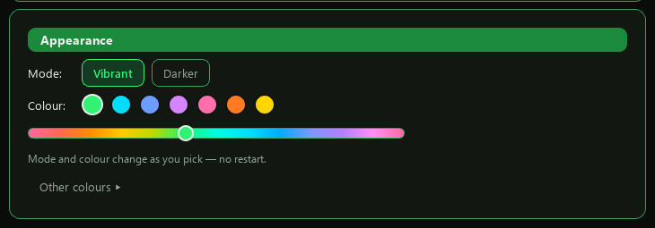

# Appearance

**Settings → Appearance** changes how OGP looks. Everything changes as you
pick it: nothing restarts.

*Settings → Appearance: Vibrant or Darker, the colour slider, and Other colours folded under it.*

## Vibrant or Darker

- **Vibrant** (the default) draws every card, button and chip with an outline
  in your colour.
- **Darker** turns those outlines down to a faint hairline and deepens the
  blacks, so only what matters lights up.

The layout is the same in both.

## Colour

One slider turns everything that's green (frames, buttons, highlights, even
the faint tint of the background) to the colour you pick. Brightness and
contrast stay, so every colour reads as well as the green.

The colours that *mean* something keep theirs: each toy's own colour, pink
for the live signal, amber for warnings, red for errors. If your colour lands
right on one of them, that one moves out of its way: pick pink, and the live
signal turns green.

## Other colours

**Other colours ▸** shows those colours, each with a slider:

- **Auto** (the default): it keeps its own colour, unless yours comes too
  close.
- Drag a slider to set it yourself. It then stays where you put it. **Auto**
  hands it back.

## One icon per thing

Some things have one icon, the same in every place OGP names them: toys are
a pink capsule, shockers a yellow bolt, the Avatar Remote a remote in your
colour, Friends two people in cyan, suits a vest in orange. The pages that are
no kind of thing (Statistics, Settings, Help, the tools) have line art in the
sidebar's own tone.
