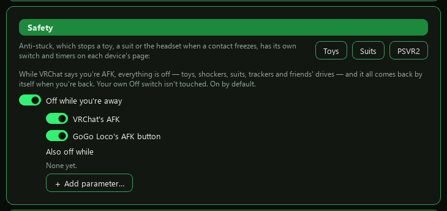

# Off while away

While VRChat says you're AFK, everything is off: toys, shockers, suits,
trackers, the headset and friends' drives. When you're back, it all comes back
by itself. It's on by default, in Settings → **Safety** → **Off while
you're away**.

*Settings → Safety: Off while you're away, with VRChat's AFK, GoGo Loco's AFK button, and Also off while.*

## What counts as away

- **VRChat's AFK**: VRChat's own `AFK` parameter.
- **GoGo Loco's AFK button**: GoGo Loco's Locomotion menu has an AFK button
  of its own. OGP sees it too.
- **Also off while**: parameters of your own choosing. **＋ Add parameter…**
  picks one; while it's on, everything is off as well. **×** takes it off the
  list.

## How it behaves

- It holds the same Off as the sidebar's **Off**, without touching your Off
  switch. Your own Off stays as you left it.
- The status bar says why, for example **AFK: everything off**.
- Friends' drives are held as with Off.
- It only counts while VRChat runs. When VRChat closes, every away reason lets
  go.
