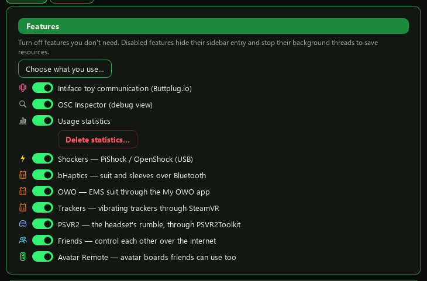

# Features

OGP does a lot; you probably need part of it. **Settings → Features**, the
first card in Settings, switches each part on or off.

*Settings → Features: Choose what you use…, and a switch per feature, each with its page's icon.*

- A switched-off feature hides its sidebar entry and stops its background work.
- Switching it back on brings everything back as you left it.
- **Usage statistics** off keeps what's recorded. **Delete statistics…**
  deletes it.

| Feature | Default | Its page |
|---|---|---|
| Intiface toy communication (Buttplug.io) | on | Toys |
| OSC Inspector (debug view) | on | OSC Inspector |
| Usage statistics | on | Statistics |
| Shockers — PiShock / OpenShock (USB) | **off** | Shockers |
| bHaptics — suit and sleeves over Bluetooth | **off** | Suits |
| OWO — EMS suit through the My OWO app | **off** | Suits |
| Trackers — vibrating trackers through SteamVR | **off** | Suits |
| PSVR2 — the headset's rumble, through PSVR2Toolkit | **off** (Windows only) | PSVR2 |
| Friends — control each other over the internet | on | Friends |
| Avatar Remote — avatar boards friends can use too | **off** | My Avatar Remote |

The Log page shows while Friends or Shockers is on.

## What are you here for?

**Choose what you use…** opens the same question a new install asks at its
first launch: tick what you have (**WHAT YOU HAVE**) and what you want
(**WHAT YOU WANT**), then **Done**. Each choice is a feature switch. It starts
from your switches as they are, so you never lose one you use. **Cancel**
changes nothing.

OGP asks it by itself only once: at the first launch of a new install.
