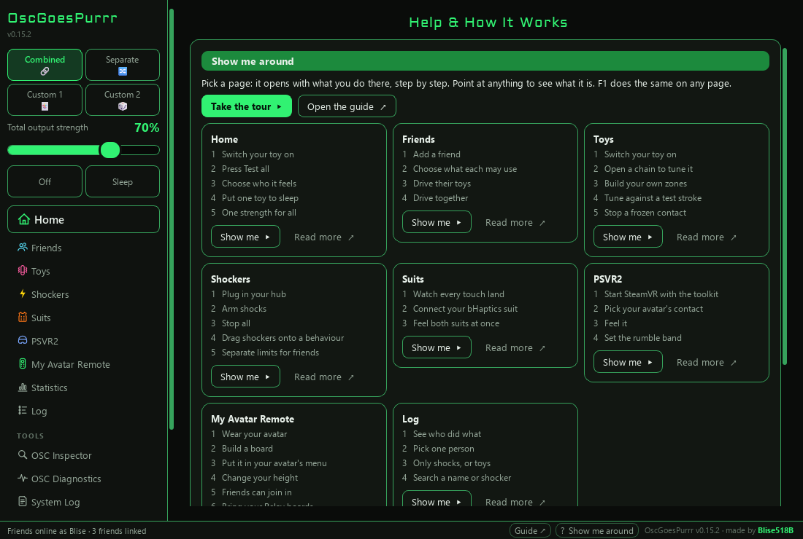

# Help, Show me around and the tour

OGP explains itself in four ways.

## Hover explanations

Rest the mouse on any control, heading or button and its explanation pops
up. Move away and it's gone. Nothing to switch on first.

## Show me around (F1)

Press <kbd>F1</kbd>, or **? Show me around** in the status bar, on any page:

- the page's steps appear on a strip above it;
- whatever you point at lights up, with its name and what it does.

Clicks do nothing while it's on, except the sidebar's pages, so looking
around never changes a setting. <kbd>Esc</kbd> leaves. The strip's **Guide ↗**
opens that page's part of this guide.

## The Help page

**Help** opens with a tile per page: its steps, **Show me ▸**, which opens
that page with Show me around on, and **Read more ↗**, its part of this guide.
Pages you switched off aren't listed. **Open the guide ↗**, next to Take the
tour, opens this guide; so does **Guide ↗** in the status bar, at the page
you're on. The long manual is folded under **Every part in detail**.

*The Help page: Take the tour, and a tile per page with its steps and Show me.*

## The guided tour

The tour walks you through OGP for real, one step at a time. It lights the
control to click and moves on when you've done the real thing: a toy
connects, its card opens, a zone is picked.

1. Switch your toy on. It lights up on Home as it connects.
2. Open it, then **Input**, then **Select Zones**: your SPS sources.
3. The four Touch / Penetration chips.
4. **Test**, then **Total output strength**.
5. Optionally, OGP's menu in your avatar.
6. A short part for each thing you picked: shockers, suits, the headset,
   friends, the avatar remote.

- Only the lit control takes clicks. The strip above the page says which step
  you're on, with **Skip this step** (or **Next**) and **End tour**.
  <kbd>Esc</kbd> ends it too.
- No toy yet? The step says what to check, and **Continue without a toy**
  moves on.
- It never changes a setting by itself. Arming the shockers is look-only.

A new install takes it right after *What are you here for?*. Take it again
any time: **Take the tour ▸** on the Help page, or **Take the tour** in Home's
Getting started.
