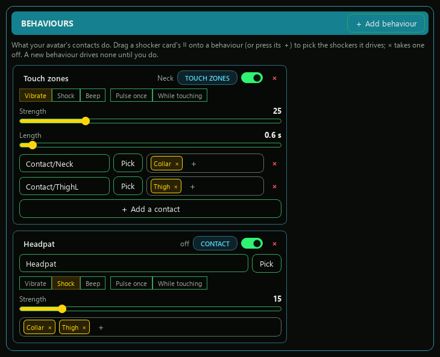

# Behaviours

A behaviour says what one of your avatar's contacts does to your shockers.
They're the cards under **BEHAVIOURS** on the Shockers page.

*Two behaviours: Touch zones (the neck drives the Collar, a thigh the Thigh shocker) and a Contact on Headpat that drives both.*

## Make one

1. Press **＋ Add behaviour** and pick its kind.
2. Pick its contact: type the parameter's name, or **Pick** one your avatar
   sends.
3. Choose what it does (**Vibrate**, **Shock** or **Beep**) and how strong.
4. Give it shockers: drag a shocker card's **⠿** onto the behaviour, or press
   its **+**. A behaviour can drive several shockers. **×** on a chip takes
   one off.

A new behaviour drives no shocker until you give it one. Its switch turns it
on and off; **×** deletes it. A shock from any behaviour is still a vibrate
until you [arm](./safety.md#arm-shocks), and stays under each shocker's
limits.

The picker lists ShockOSC's parameters first, and keeps PhysBone states
(`…_IsGrabbed`, `…_Stretch`) visible, since behaviours use them.

## The kinds

### Touch zones

Several contacts, each driving its own shockers: the neck the collar, a thigh
its shocker. One action, strength and length for all of them; each contact's
row takes its own shockers. **＋ Add a contact** adds a row.

### Contact

One on/off contact at a fixed strength:

- **Pulse once**: one pulse each time it's touched, of the set **Length**.
  **Touch for at least** ignores a brush shorter than that.
- **While touching**: running for as long as it's touched.

### Continuous

A value from your avatar, usually a proximity contact, runs the shockers
while it's above **Starts above**. The closer, the stronger: from **Strength
just past it** to **Strength at 1**.

### Impact

Several OnEnter contacts on one spot, each with a different **Min Velocity**
on the avatar. The hardest hit that fired picks the strength, so a slap lands
harder than a tap. Each tier is a contact and a strength.

### Pull

A PhysBone, like a tail or an ear:

- **While held**: Nothing, Vibrate, Shock or Beep.
- **When let go**: one pulse (Vibrate, Shock or Beep), the harder the pull the
  stronger: from **Strength at a slight pull** to **Strength at full
  stretch**.

Pick the PhysBone's `_IsGrabbed` or `_Stretch` parameter, or type its name.
ShockOSC's PhysBones work this way.

## When several want one shocker

Your own behaviours pick the strongest among themselves for each shocker.
With friends holding the same shocker, the strongest hold plays, and a shock
beats a vibrate. A behaviour skips a shocker whose action it uses is switched
off, so another behaviour can have it.

Everything your avatar does to your shockers is in the
[Log](../records/log.md) as **Your avatar**, with the behaviour's name.
