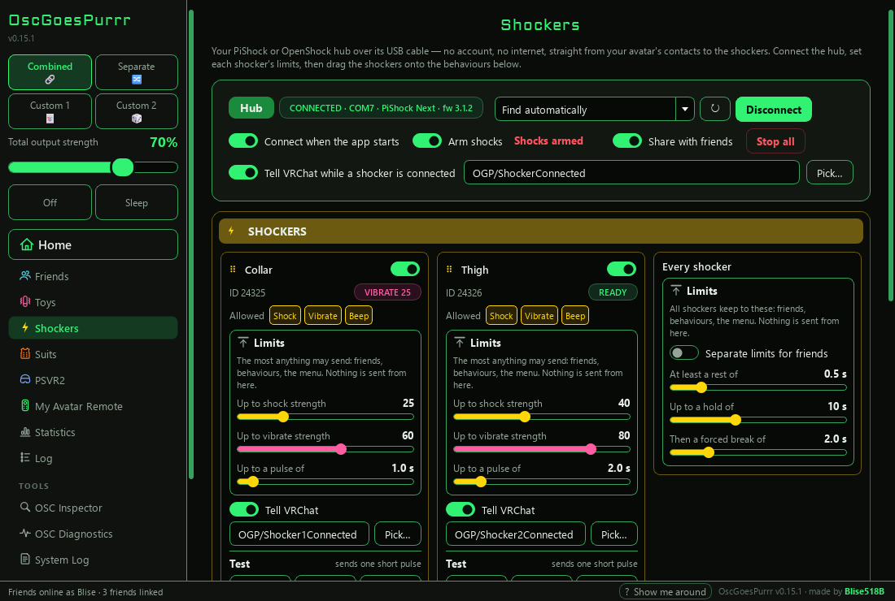
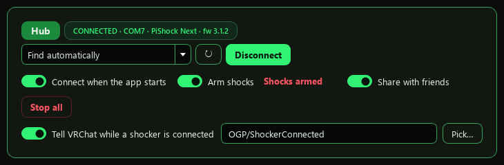
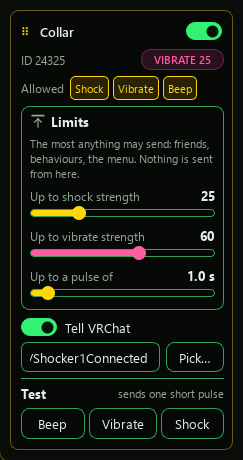

# The hub

OGP drives PiShock and OpenShock shockers through the hub's **USB cable**:
no account, no internet, straight from your avatar's contacts to the
shockers. It never uses the PiShock or OpenShock cloud.

Switch it on first: Settings → Features → **Shockers — PiShock / OpenShock
(USB)**, or tick **A shocker** in *What are you here for?*. It's off by
default.

:::warning
Read [Arming and limits](./safety.md) before you put a shocker on. Shocks go
out as vibrates until you arm them.
:::

*The Shockers page: the hub, a card per shocker with its limits, and the behaviours below.*

## Connect the hub

1. Plug the hub into this PC by USB.
2. On the **Shockers** page, leave the port on **Find automatically** (or pick
   one; **↻** looks for ports again) and press **Connect**.
3. **Connect when the app starts** connects it every time from then on.

*The hub card: connected to a PiShock hub on COM7, with Arm shocks, Share with friends, Stop all and Tell VRChat.*

## PiShock or OpenShock

The hub can run **PiShock**'s own firmware or **OpenShock**'s: PiShock's 2023
and Lite hubs can be reflashed with it, and so can a DIY ESP32 board with a
433 MHz transmitter (CaiXianlin or Petrainer collars). OGP finds out which
when it connects.

- A **PiShock** hub lists its shockers itself. Each gets a card.
- **OpenShock** firmware keeps no list, so add each shocker yourself:
  **＋ Add shocker** makes a card with a model and a fresh transmitter ID. To
  pair a collar, hold its power button until the light blinks fast, then
  press the card's **Beep**. A PiShock shocker counts as CaiXianlin.

## A shocker's card

*One shocker's card: its On / Off switch, what it's allowed to do, its limits, Tell VRChat and the test buttons.*

- **The name**: click to rename it. The number in front of it on your
  friends' panels is the card's place.
- **On / Off**: a switched-off shocker stops at once and nothing reaches it.
  Its card stays where it is, greyed, with only its switch lit. Behaviours,
  friends and the web remote don't see it.
- **Allowed**: **Shock**, **Vibrate** and **Beep**, each switched on or off
  for this shocker. See [Arming and limits](./safety.md#shock-vibrate-and-beep).
- **Limits**: **Up to shock strength**, **Up to vibrate strength**, **Up to a
  pulse of**. The most anything may send to this shocker. Nothing is sent from
  here.
- **Tell VRChat**: a Bool that's true while this shocker is in use. See
  ["It's connected" parameters](../avatar/connected-parameters.md).
- **Test**: **Beep**, **Vibrate**, **Shock** send one short pulse each, under
  the shocker's limits. The button of an action you switched off rests.

The **Every shocker** card holds the limits all shockers share: **At least a
rest of**, **Up to a hold of**, **Then a forced break of**.

## Stop all

**Stop all** stops every shocker at once and refuses everything until you
press **Resume**. It's the same setting as **On** on Home's shocker row.

These stop the shockers at once too:

- **Off** in the sidebar, or `OGP/Off` from your avatar's menu;
- [Off while you're away](../settings/away.md);
- the USB cable coming out;
- VRChat going silent.

## On Home

Home's shocker row has **Arm shocks**, **Share with friends** and **On**:
the very same switches as on this page. A click on the row opens this page.
