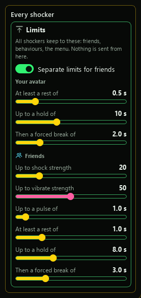

# Arming and limits

A shock reaches a person, so every send goes through one gate in OGP, whoever
sends it: your avatar, your menu, a friend, the web remote. These rules hold
for all of them.

:::warning The rules
1. **Shocks are vibrates until you arm them.** Unarmed, every shock (yours or
   a friend's) goes out as a vibrate.
2. **Arming asks first.** Nothing arms the shockers without a **Yes** from
   you.
3. **Limits only ever get stricter.** Friends and your avatar can lower a
   shocker's limits, never raise them. ShockOSC's settings are a behaviour's
   own values: they never move a limit.
4. **A switched-off action never fires.** A shocker with Shock switched off
   never shocks, whoever asks.
:::

## Arm shocks

**Arm shocks** is on the Shockers page's hub card and on Home's shocker row.
It's one setting, shown in both places: flip it in one and the other follows.

- Switching it on asks: the switch turns into **Arm shocks? Yes / No**, right
  where it is. No answer within 5 seconds, and it stays off.
- Switching it off never asks.
- Red words beside it always say **Shocks armed** or **Shocks not armed**.
- It's remembered when you restart OGP.
- A Ctrl+Z that would arm the shockers asks the same question.

Your friends see whether you're armed: their panel says **Not armed · a
shock arrives as a vibration**.

## How the switches stack

From everyone to one friend:

**On** (the hub) → **Arm shocks** (real shocks) → **Share with friends**
(friends at all) → each friend's own **Shockers** switch on the Friends page
(and the web remote's).

Off stops everything, whatever the rest say. Not shared, no friend sees your
shockers at all.

## Limits

Each shocker card has a **Limits** box, and the **Every shocker** card holds
the shared ones. They're the most anything may send; nothing is sent from
there. The engine applies them to every send.

| Limit | For | Default | Range |
|---|---|---|---|
| **Up to shock strength** | each shocker | 30 | 1–100 |
| **Up to vibrate strength** | each shocker | 30 | 1–100 |
| **Up to a pulse of** | each shocker | 1.0 s | 0.1–15 s |
| **At least a rest of** | every shocker | 0.5 s | 0.1 s – 1 h |
| **Up to a hold of** | every shocker | 10 s | 1 s – 10 min |
| **Then a forced break of** | every shocker | 2.0 s | 0.5 s – 10 min |

- After anyone's pulse, that shocker rests for everyone, you included. A
  stronger pulse may still cut in: a shock cuts into a vibrate or a beep
  whatever their strengths, a vibrate into a beep, and within one kind the
  stronger one. Even then the pulses in a row never last longer than one
  longest pulse.
- A hold that reaches the longest hold stops, and the shocker takes its
  forced break. Holds by several people count as one hold. No pulse goes in
  during that break either, and a hold waits until a pulse and its rest are
  over.
- A friend sends a part of *your* limit: their strongest is your **Up to …**
  (or the friends' own, with Separate limits for friends on), the same for
  every friend (see [What each friend may do](../friends/what-they-may-do.md)).
- Nothing in OGP's settings goes past 100 % strength or a 15 s pulse.

### Separate limits for friends

The **Every shocker** card's Limits box has one switch: **Separate limits
for friends**. It's off by default.

- **Off:** one set of timing for everyone, and one count. A friend's long
  hold and its forced break hold your avatar's contacts back too.
- **On:** the three timing limits come twice. **Your avatar** (your
  behaviours, ShockOSC's behaviours and your avatar menu) keeps to the first
  set, **Friends** (every friend, Me and the web remote) to the second, and
  each is counted on its own. A friend's long hold never blocks your contact
  shocks, and the other way round.
- **Friends' caps:** with it on, the Friends set also has **Up to shock
  strength**, **Up to vibrate strength** and **Up to a pulse of**. They hold
  for every friend on every shocker and only ever lower a shocker's own: a
  friend gets the lower of the two. Your avatar keeps each shocker's own.
- **The catch:** with it on, your avatar's longest hold and a friend's can
  run back to back, without the forced break between them.
- Arming and each shocker's switches stay shared either way.
- The first time you switch it on, the friends' set starts as a copy of
  your current values (each cap at the highest any shocker has), so nothing
  changes until you move one. Friends' panels show the caps and the longest
  hold they get.

*Separate limits for friends on: your avatar's timing, then the Friends set
with its own caps and timing.*
- Switching it on, or raising a friends' limit, loosens the shocker rules:
  a Ctrl+Z that would do either asks first.

## Shock, Vibrate and Beep

Each shocker's card has **Allowed: Shock · Vibrate · Beep**. One switched off
is refused for that shocker, whoever sends it: your behaviours, your avatar's
menu, friends, the web remote.

- Switching one off stops a running pulse or hold of it at once.
- An unarmed shock is a vibrate, so with Vibrate off it's refused as well.
- A behaviour that uses a switched-off action greys that shocker's chip.
- Friends see the button greyed, with why: *"Shock is switched off on their
  side"*. Nothing switched off ever reaches the shocker.
- A shock that must be warned first, on a shocker with both Vibrate and Beep
  off, is held back there and logged: it can't warn.

## Several people on one shocker

When you, a friend and someone on your web remote hold one shocker at once,
it plays the strongest hold steadily. A shock always wins over a vibrate,
whatever their strengths, and a vibrate over a beep. One of them letting go
doesn't cut the others.

## Everything that stops the shockers

- **Stop all** on the hub card (or **On** off on Home);
- the shocker's own **On / Off**;
- **Off** in the sidebar, or `OGP/Off`;
- [Off while you're away](../settings/away.md);
- the USB cable coming out, and VRChat going silent;
- **Pause all** on the Friends page, for everything friends send.
