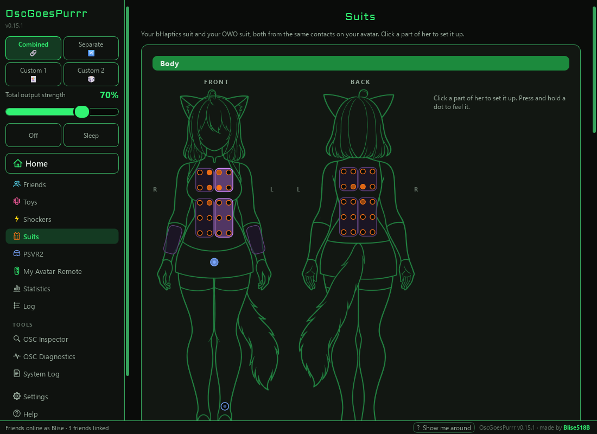

# bHaptics

OGP drives a bHaptics suit, sleeves, hands, feet or head straight over
Bluetooth: no bHaptics Player, no pairing in Windows. It plays your avatar's
bHaptics contacts, and OWO's too if you like.

Switch it on first: Settings → Features → **bHaptics — suit and sleeves over
Bluetooth**, or tick **A bHaptics suit or sleeves** in *What are you here
for?*. It's off by default. Its page is **Suits**, shared with OWO and the
haptic trackers.

*The Suits page: front and back, every bHaptics motor an orange dot, OWO's muscles purple patches, and a haptic tracker as a blue puck.*

## The body

The Suits page is a body, front and back. Every bHaptics motor is an orange
dot; OWO's muscles are purple patches around them; haptic trackers are blue
pucks.

- **Click** a part of her to set it up: its card opens beside her, with a line
  to it. A click on empty space closes it.
- **Press and hold** a dot to feel it.
- Each card says whether the avatar you wear has that part's contacts. A
  dashed amber ring marks what's missing.
- Touches light up as they land.

## Connect

1. **Close the bHaptics Player.** A suit takes one connection at a time.
2. Switch the suit on.
3. Press **Connect** on the bHaptics card. **Connect when the app starts**
   does it every time from then on.

**Let go** hands the suit back to the Player or a game.

## What you have

**You have** lists the bHaptics parts: tick the ones you own. Only those
show on her. A vest is ticked by default, and a part that connects ticks
itself.

## Your avatar's contacts

All of these work, with no setup:

- the official bHaptics avatar package (`bOSC/v2…`);
- older bHapticsOSC setups;
- with **Also feel OWO's contacts** on (the default), the OWO avatar package's
  contacts play the bHaptics motors around them.

**Zone routes** send an SPS zone or one of your
[SPS Sources](../toys/toys-page.md#sps-sources) to a part of the body, for
both suits: **Add route**, then its zone, type and gain.

## Safety

- If OGP stops sending, the suit goes quiet within a quarter of a second.
- Off, VRChat going silent, [Off while away](../settings/away.md) and the
  suit's own [anti-stuck](../toys/toy-safety.md) (its **Anti-stuck** card in
  the bHaptics frame, with its own times) hold the suit too. The OWO suit has
  its own in the OWO frame.
- **Tell VRChat** sends `OGP/BHapticsConnected`, and one per part. See
  ["It's connected" parameters](../avatar/connected-parameters.md).
