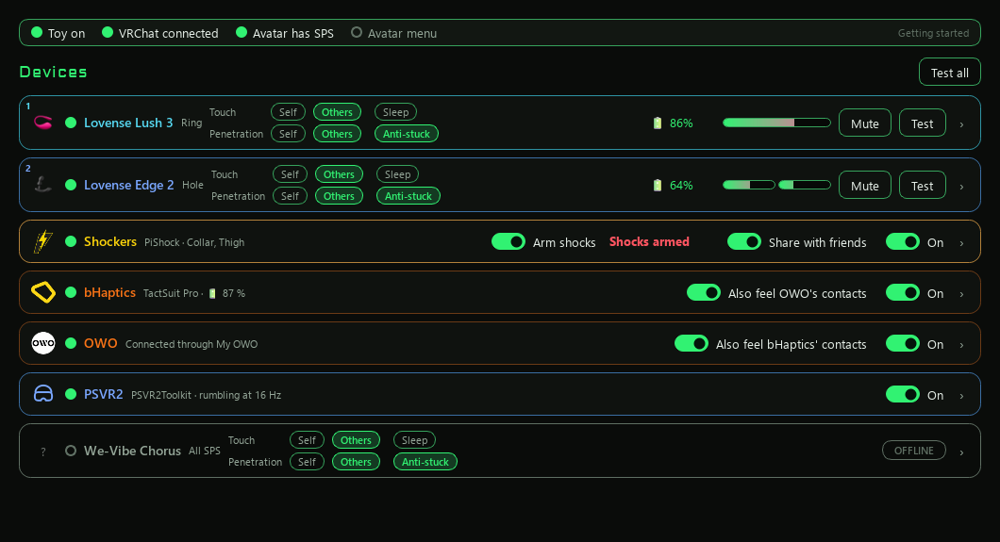
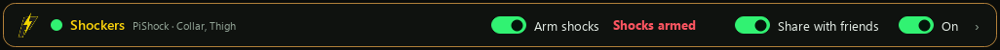

# Home

Home is where OGP opens: a row for everything you have, with its quick
switches. The details live on each device's own page. Click a row to open it
there.

*Home's Devices: two connected toys, the shocker hub, the bHaptics and OWO suits, the PSVR2 headset, and a toy that's switched off, greyed at the bottom.*

## Getting started

Until the basics work, the top of Home shows **Toy on · VRChat connected ·
Avatar has SPS · Avatar menu**, a dot each. It goes away once the first three
are green. **Don't show again** folds it to one slim line for good, and
**Take the tour** starts the [guided tour](../settings/help-and-tour.md).

## Devices

**Test all** buzzes every connected toy gently for about a second.

### A toy's row

Every toy you've connected gets a row, outlined in its own colour and
numbered in the corner. The number is its place: toys keep the order they
connected in, and friends see them in that order too.

From left to right:

- **Its name and a dot**: green while connected. A toy you've used before but
  that's switched off stays listed, greyed, with **OFFLINE**.
- **What drives it** in the active mode: **All SPS**, a zone's name, or how
  many zones.
- **The four chips**: **Touch** from **Self** / **Others**, **Penetration**
  from **Self** / **Others**. A chip sets that choice on every chain of the
  toy, in the active mode. It shows half lit while the toy's chains disagree;
  a click makes them all agree. A chip greys out when none of the toy's chains
  hears that kind.
- **Sleep** over **Anti-stuck**: Sleep puts just this toy to sleep (three
  full strokes wake it); Anti-stuck, on by default, can leave this one toy
  out. See [Anti-stuck and Sleep](./toy-safety.md).
- **Battery**, and a **live meter** per motor.
- **Mute** silences this one toy. **Test** buzzes it.

In a wide window it's all one line: the name, then the chips as two rows,
**Touch** above **Penetration** with **Sleep** over **Anti-stuck** beside
them, then the battery, meters, **Mute** and **Test**. Only when the window
gets narrower do the zones and chips move to a line under the name, and in a
narrow one the battery and meters get a line of their own too.

### The shocker hub's row

**Arm shocks**, **Share with friends** and **On**, with red words that say
**Shocks armed** or **Shocks not armed**. These are the same switches as on
the Shockers page: flip one and the other follows. Arming asks first. See
[Arming and limits](../shockers/safety.md). In a narrow window **Arm shocks**
and **Share with friends** move to a line under the name; **On** stays at the
end.

*The shocker hub's row: PiShock with two shockers, armed, shared with friends, and on.*

### Suits and the headset

The bHaptics and OWO suits each have **On** and **Also feel OWO's contacts** /
**Also feel bHaptics' contacts**. The PSVR2 headset has **On**. See
[Suits and trackers](/suits/) and [PSVR2](../psvr2.md).

## The sidebar

The sidebar shows the same things on every page: the four mode buttons,
**Total output strength**, **Off** and **Sleep**, then the pages, then
whether **VRChat** and **Intiface** are connected. See
[Modes, strength, Off and Sleep](./modes.md).
