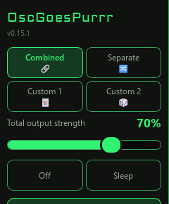

# Modes, strength, Off and Sleep

The top of the sidebar is the same on every page: four mode buttons, **Total
output strength**, **Off** and **Sleep**.

*The four modes (Combined is active), total output strength at 70 %, Off and Sleep.*

## Modes

A mode is a **routing**: which parts of your avatar drive which motors. It
isn't how strong anything is. There are four, and one is active at a time:

- **Combined**: every socket feeding one motor.
- **Separate**: each socket driving its own motor.
- **Custom 1** and **Custom 2**: anything in between.

Right-click a mode to rename it or change its icon.

Each mode keeps its own copy of every motor's Input stage: its zones, its
parameters, who it hears, and its mirror to VRChat. Everything else is shared:
the feel of every chain, each toy's output gain and range, the strength.
So you tune a toy once, and a mode only changes how it's wired.

**Remember mode per avatar** (Settings → Modes) switches to the mode each
avatar last used when you put it on.

From VRChat, `OGP/Mode` (0 to 3) switches modes. See
[The avatar menu](../avatar/menu.md).

## Total output strength

One multiplier on everything your toys get. It never touches your tuning, so
turning it back up gives you exactly the feel you had. From VRChat it's
`OGP/Strength`.

If one toy always feels stronger than the rest, leave the slider alone and
trim that toy instead: Toys → the toy → its chain → **Output → Gain**. If a
motor does nothing until well up its range, or gets unpleasant near the top,
set **Output → Range** to the part it really uses. Both hold in every mode.

## Off

Panic silence. Everything stops at once, whatever the slider says: toys,
shockers, suits, trackers, the headset and friends' drives. Switch it back off
and your level returns untouched.

While you're AFK in VRChat, OGP holds the same Off for you without touching
your switch. See [Off while away](../settings/away.md).

## Sleep

Makes every toy hard to wake. Every chain's **Wake** stage switches to
counting strokes: nothing plays until three full strokes land within six
seconds. A brush against a sleeping partner does nothing. Your own Wake
settings come straight back when you switch Sleep off. Buttplug toys only.

Each toy's bar has a **Sleep** chip of its own, for that toy alone. While the
sidebar's Sleep is on, every toy's chip is lit. See
[Anti-stuck and Sleep](./toy-safety.md).

:::note
Off and Sleep aren't remembered when you restart OGP, on purpose: starting in
silence, or in a sleep nobody remembers switching on, looks like a broken app.
:::
