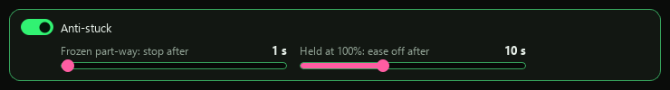
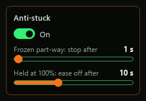
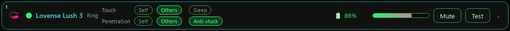
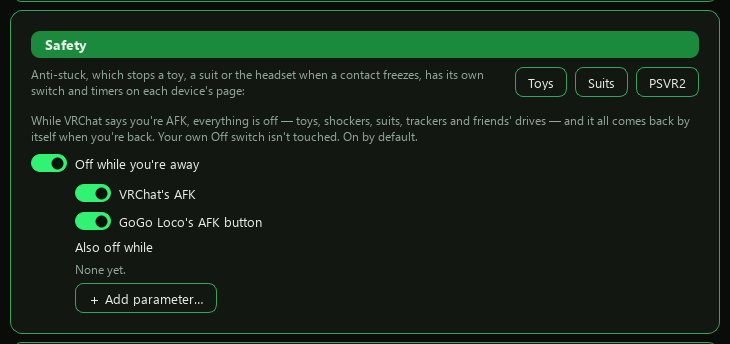

# Anti-stuck and Sleep

VRChat only sends a value when it changes. If a contact stops updating (you
swap avatar, your partner leaves, the link drops), its last value would keep
a toy, a suit or the headset running. **Anti-stuck** notices a value that has
frozen and stops it. It's on by default.

Each kind of device has its own anti-stuck, with its own switch and times,
on its own page, because they may want different settings:

| Device | Where |
|---|---|
| Your toys | The **Toys** page, under Toy server. Each toy's bar has its own switch too. |
| The bHaptics suit | The Suits page, the bHaptics frame's **Anti-stuck** card. |
| The OWO suit | The Suits page, the OWO frame's **Anti-stuck** card. |
| Haptic trackers | The Suits page, under her, after the trackers. |
| The PSVR2 headset | The PSVR2 page, at the bottom of the **Contact** card. |

*The Toys page: anti-stuck for every toy, under Toy server.*

## The two times

A real contact between zero and one never holds perfectly still: animation
and IK jitter it all the time. So:

- **Frozen part-way: stop after** (1 s by default): a value that stops moving
  somewhere in the middle is cut quickly.
- **Held at 100%: ease off after** (10 s by default): all the way in and held
  is a real state, so it gets the longer wait, then eases off over 3 s.

A new value brings it back at once. The times are sliders, from 1 s to
10 minutes; they hide while the switch is off.

*Each suit has its own, in its frame on the Suits page.*

If you updated from an older OGP, each one starts with the switch and times
you had: before, one anti-stuck in Settings covered them all.

## One toy: Sleep and Anti-stuck

Each toy's bar, on Home and on the Toys page, has two chips beside Touch and
Penetration:

- **Sleep** puts just this toy to sleep: nothing from your avatar's contacts
  plays on it until three full strokes land within six seconds, so a brush
  against a sleeping partner does nothing. After 45 seconds without a stroke
  it sleeps again. While the sidebar's **Sleep** is on, every toy sleeps and
  every chip is lit (and greyed). Like the sidebar's, it isn't remembered when
  you restart OGP. Friends' drives still reach a sleeping toy.
- **Anti-stuck** is on for every toy by default. Switch it off for a toy that
  should keep playing a value that sits still. It only counts while the Toys
  page's anti-stuck is on (greyed while that is off), and it's remembered, the
  same in every mode.

*A toy's row: the Touch and Penetration chips, then Sleep over Anti-stuck.*

Ctrl+Z asks first before it would switch an anti-stuck off or make it wait
longer, as doing it by hand would.

## Settings → Safety

Settings' **Safety** card (called Toy Safety before) holds **Off while you're
away**: while VRChat says you're AFK, everything is off. See
[Off while away](../settings/away.md). Above it, a button for each page with
an anti-stuck takes you there.

*Settings → Safety: buttons to each device's anti-stuck, and Off while you're away.*

## Other things that stop your toys

- **Off** in the sidebar, or `OGP/Off` from your avatar's menu.
- **Mute** on a toy's row silences that one toy.
- OGP's **Test** pulses (Test all, a toy's Test, `OGP/Test`) are gentle: about
  20 % for a moment.
