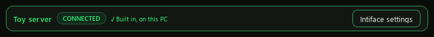

# Where your toys connect

OGP talks to toys through a toy server: Intiface, the Buttplug.io engine.

- **Built in** (the default): OGP runs Intiface for you, on this PC. Nothing
  else to install or start.
- **Your own Intiface Central**: on this PC, or on a phone or another PC on
  the same network. Use it when your toys are paired with Intiface Central on
  your phone.

The Toys page's **Toy server** line, and the sidebar's **Intiface** row, say
which one OGP uses and whether it's connected.

*The Toys page's Toy server line: connected, built in, on this PC.*

## Use Intiface Central on a phone

1. On the phone, open Intiface Central (3.0 or newer) and switch on **Listen
   on all network interfaces**.
2. Also switch on **Broadcast Server Info via mDNS** (under Show
   Advanced/Experimental Settings). Then OGP finds the phone by itself.
3. Start the server on the phone, and keep the app open while you play.
4. In OGP: Settings → **Intiface Engine** → switch off **Use built-in Intiface
   engine**.
5. Leave **Address** empty and OGP looks on this PC and your network until one
   answers. Or type the phone's address, like `192.168.1.50` (add `:port` if
   you changed Intiface's Server Port).

The line under the address says when it's connected: **✓ Connected to …
at …**. Finding a phone without an address needs Intiface Central 3.1.

Switching between built in and your own reconnects by itself.

:::info
With your own Intiface Central, Intiface's own device list applies. The
built-in engine leaves one entry out, so it never takes a Bluetooth serial
device (a MeshCore radio, an ESP32 board) for a toy.
:::
