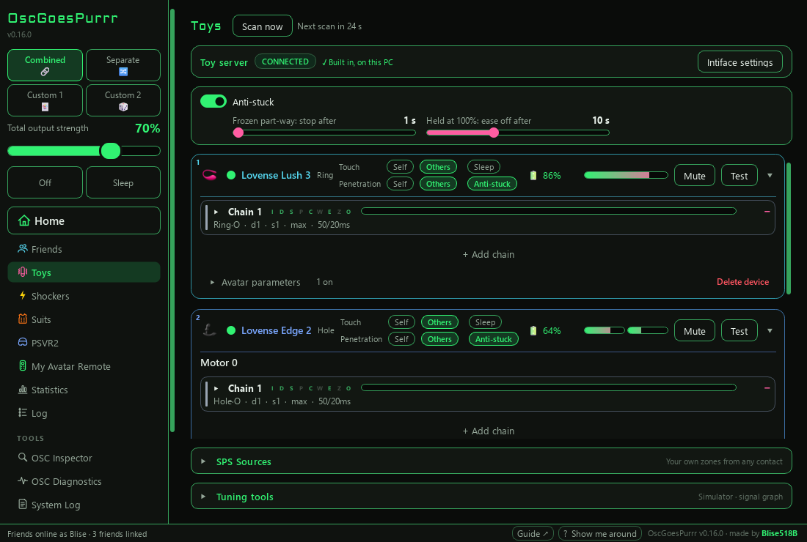
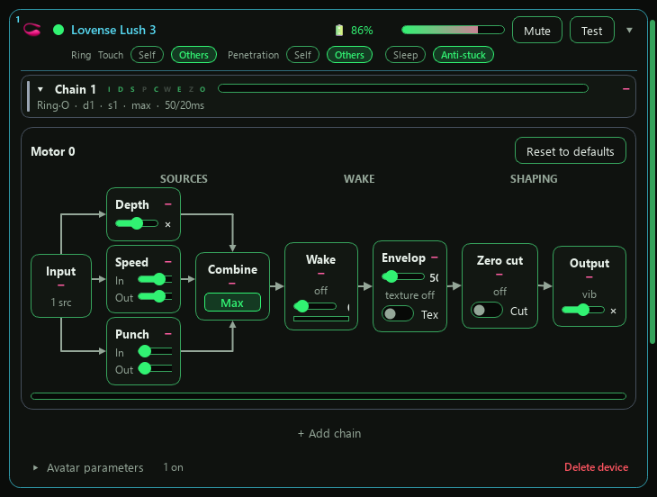

# The Toys page

Home shows each toy at a glance. The **Toys** page, right under Friends in
the sidebar, holds everything about them: each toy's signal chains, the toy
server, SPS Sources and the tuning tools.

*The Toys page: Scan now, the Toy server line, anti-stuck, and a card per toy. SPS Sources and Tuning tools are folded at the bottom.*

## Scan now

OGP looks for toys by itself: every few seconds while no toy is connected,
every 30 seconds while one is. **Scan now** looks right away, for a toy you
just switched on. Beside it, OGP says when it looks next.

## Toy server

Whether the toy server is **CONNECTED** and where it runs: built in, on this
PC, or your own Intiface Central. **Intiface settings** opens
Settings → Intiface Engine. See [Where your toys connect](./toy-server.md).

## Anti-stuck

Under Toy server: anti-stuck for every toy, with its two times. It stops a
toy whose contact has frozen. Each toy's bar has its own **Anti-stuck** chip
to leave one toy out. See [Anti-stuck and Sleep](./toy-safety.md).

## A toy's card

A card's bar is the same as the toy's row on Home: the four chips, **Sleep**
and **Anti-stuck**, battery, meters, **Mute** and **Test**. Under it, the card is already open on each
motor's chains, each folded to one bar: its name, a letter per stage lit by
its live level, and its settings at a glance. Click a chain to open it. A
click on the toy's bar folds the whole card away, and another brings it back.

*A toy's chain opened: Chain 1 of its motor, from Input through Depth, Speed and Punch, Combine, Wake and Envelope to Zero cut and Output.*

### Signal chains

Each motor has a **signal chain**: the stages that turn your avatar's contacts
into the motor's level. Click a stage to edit it. Rest the mouse on a stage to
see what each knob does.

| Stage | What it does |
|---|---|
| **Input** | Where the signal comes from: which zones, touch or penetration, from you or from others. |
| **Depth** | How deep or close the contact is: the steady part of the feel. |
| **Speed** | How fast the contact moves: the lively part. It fades once movement stops. |
| **Punch** | A short hit on top of a fast thrust in (or pull out), then it decays. |
| **Combine** | How Depth and Speed merge: **Max** (the louder wins, the default), **Add** or **Multiply**. |
| **Wake** | Nothing plays until there's real contact. **Strokes** mode waits for full strokes, which is what Sleep uses. |
| **Envelope** | How the level moves over time: smoothing, and an optional texture so a steady hold feels alive. |
| **Zero cut** | Snaps to silence the moment the contact is gone, instead of fading out. Off by default. |
| **Output** | A gain to balance this toy against the others, and the range the toy can use. |

A motor can have up to six chains. **+ Add chain** adds one that runs on the
same input. A chain can be for **Penetration**, **Touch** or **Custom**; a
coloured bar on its fold row says which.

**Reset to defaults** puts a chain's feel back to OGP's own.

### Its zones

1. Open its chain, then click **Input**.
2. Click **Select Zones**. These are your SPS sources: **All SPS** hears every
   SPS zone your avatar has. Or switch on only the ones you want: the zones
   VRChat reports for the avatar you wear, and the ones you built under
   [SPS Sources](#sps-sources).
3. **Who it hears**: Touch from yourself, Touch from others, Penetration from
   yourself, Penetration from others. They're the same four as the chips on
   the toy's bar.

The zones are kept per [mode](./modes.md). The feel isn't: you tune it once.

### Your own parameters

**+ Add Variable**, in a chain's Input stage, maps any OSC parameter to the
motor. The motor follows the loudest of them, plus its zones.

The picker hides what's rarely wanted: VRChat's own parameters, GoGo Loco,
face tracking, VRCFury's internals, physics assets, PhysBone states, OGP's
own and SPS's. Each group is a chip with its count at the top of the picker.
A lit chip hides its group, and **Show everything** shows them all. A search
also finds hidden ones, under **Hidden by filters**. A parameter you already
mapped is never hidden.

### At the bottom of the card

One small line, after every motor's chains:

- **Avatar parameters** is folded, and says how many are on. Open it for:
  - **Mirror to VRChat parameter**, one per motor (named by its motor when
    the toy has several). It sends the motor's level (0 to 1) back to your
    avatar, for a glow or a fill meter. Type the name, or **Pick…** one your
    avatar sends.
  - **Tell VRChat while this toy is connected**, a Bool, on by default. See
    ["It's connected" parameters](../avatar/connected-parameters.md).
- **Delete device**, at the right end, forgets the toy and everything set up
  for it, in every mode. Switch it on again and it comes back as a new toy.

## SPS Sources

Your own zones, built from raw VRChat contact receivers: for spots the
standard SPS zones don't cover, or an avatar without them. Each source is a
zone you can pick in any toy's Input stage, like your avatar's own.

A source combines:

- **Proximity**: one or more proximity receivers. The loudest wins.
- **Activation**: on/off contacts. The proximity only counts while one of them
  fires. Leave it empty for no gate.
- **Velocity**: on-enter contacts. While one fires, the level is multiplied by
  **Velocity ×**.
- **Max value**: a cap on the proximity before the multiplier.

Type the contact names separated by commas. The `/avatar/parameters/` prefix
is optional. Sources are shared by every mode.

## Tuning tools

For when you shape how a toy responds:

- the **input simulator**: a stroke to tune against, without a partner;
- the **signal graph** of one chain.

The fold remembers whether you left it open.

## Chimes and SteamVR

- A chime plays when a toy connects (going up) or disconnects (going down).
  Settings → Connection Settings → **Sound when a toy connects or
  disconnects** switches it off, with its volume beside it.
- **Show toys in SteamVR** (Settings, on by default, Windows only) lists your
  connected toys in SteamVR's device strip with their battery. Just for show:
  they can never be picked up as trackers. Switching it off takes them out of
  SteamVR again. A PC without SteamVR is never touched.
